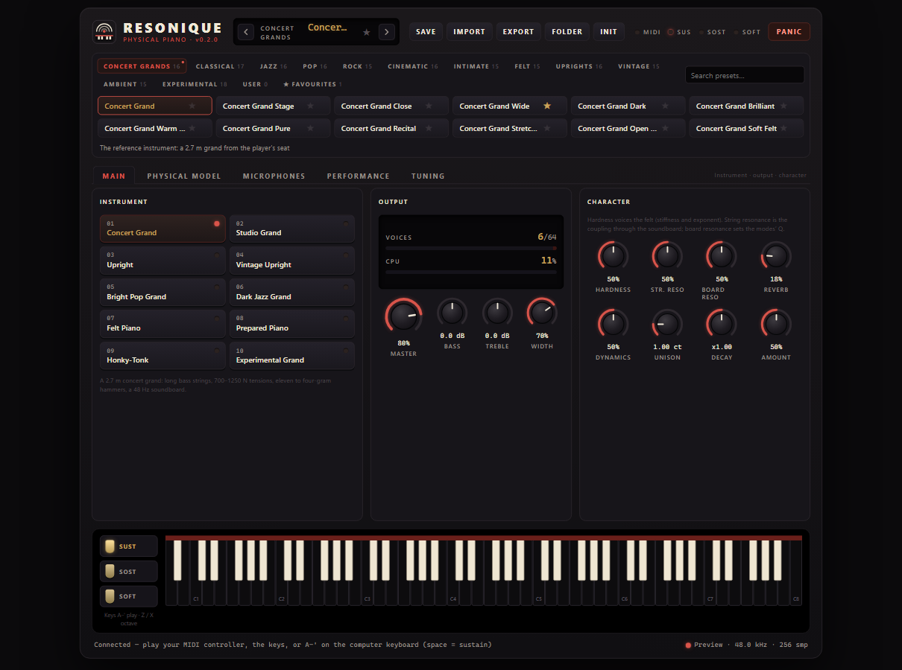
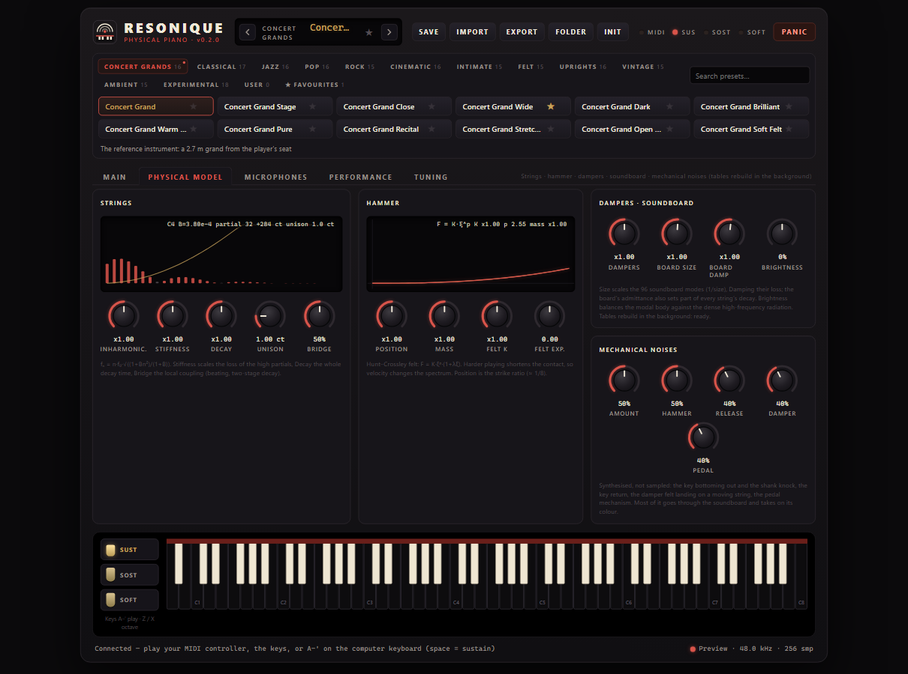
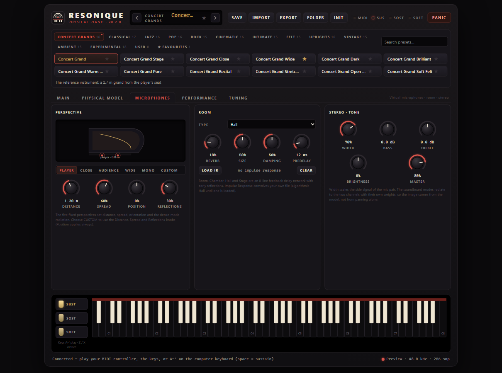
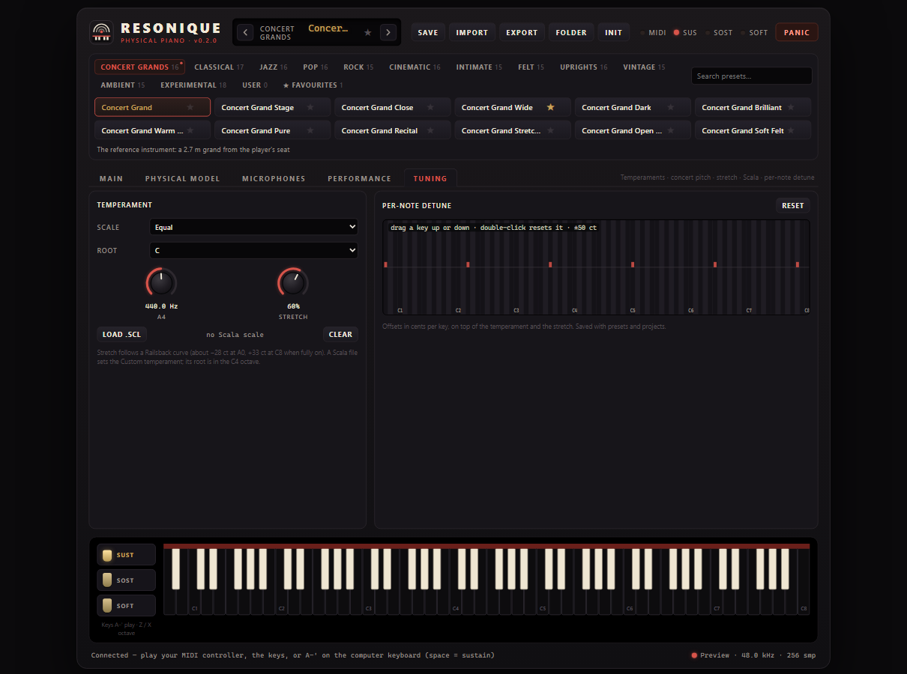

# Resonique — v0.2

Resonique is a physically modelled acoustic piano: no samples, every note is computed from a stiff-string modal
model struck by a nonlinear felt hammer, coupled through a modal soundboard that carries sympathetic resonance back
into every undamped string. It is a Windows x64 **VST3 plugin** and a **Standalone app**, and the sixth instrument
in the family after [E-Piano](https://github.com/BlinkZer0/E-PianoVST), Brass Knuckles, No Strings, The Ham and
Eight Ball: same console, same preset system, same build.

| Build | Where | Status |
|---|---|---|
| **VST3 plugin** + Standalone | [`vst/`](vst/README.md) | phases 1–7 of the plan built and tested: the engine, ten instruments, 190 presets, the five-page console, automated DSP / acoustic / preset / host tests, benchmark, release packaging |



| PHYSICAL MODEL | MICROPHONES |
|---|---|
|  |  |

| PERFORMANCE | TUNING |
|---|---|
|  |  |

(made by `vst\tests\run-ui-tests.ps1` from the real UI with a stand-in bridge; `run-standalone-check.ps1`
screenshots the real Standalone window.)

## What it does

**The model** (details in [docs/ACOUSTICS.md](docs/ACOUSTICS.md))
- **Strings:** up to 128 modes per string, stiff-string partial series `f_n = n·f₀·√((1+Bn²)/(1+B))` with *B* from
  each key's length, tension and core diameter; losses from air, viscoelasticity and the soundboard's admittance;
  rotation resonators in float with no trigonometry in the audio loop. Partials that have died are dropped.
- **Hammer:** a mass with a Hunt–Crossley felt law `F = K·ξ^p·(1+λξ̇)`; harder blows shorten the contact and
  brighten the tone. Integrated at 192 kHz sub-steps so the result is the same at every sample rate.
- **Unisons:** one, two or three strings per key with per-string detune and a local bridge (mass + resistance) that
  couples them: beating and two-stage decay fall out of the physics.
- **Soundboard:** 96 shared modes over eight bridge zones, radiating to left and right with their own weights;
  the zone accelerations feed back into every undamped string.
- **Sympathetic resonance:** a light modal copy of every key rings when its damper is off, driven by the board,
  so harmonically related keys respond and others do not.
- **Pedals:** continuous sustain (half-pedal, re-pedalling), sostenuto, soft (una corda), with the dampers acting on
  the actual string losses; the top twenty keys have no dampers.
- **Mechanical noises:** synthesised hammer / key / damper / pedal sounds, mostly through the soundboard.
- **Microphones and room:** player / close / audience / wide / mono / custom perspectives, early reflections, an
  8-line FDN reverb (Room, Chamber, Hall, Stage) or your own impulse response.
- **Tuning:** equal plus seven historical temperaments, Scala `.scl` import, concert pitch, Railsback stretch, a
  per-note detune editor.

**Ten instruments:** Concert Grand, Studio Grand, Upright, Vintage Upright, Bright Pop Grand, Dark Jazz Grand, Felt
Piano, Prepared Piano, Honky-Tonk, Experimental Grand: different string scalings, hammers, dampers and boards, not
EQ presets.

**190 factory presets** in 12 categories (Concert Grands, Classical, Jazz, Pop, Rock, Cinematic, Intimate, Felt,
Uprights, Vintage, Ambient, Experimental), generated from physical recipes, level-matched, each one a distinct set
of synthesis parameters (the build refuses near-duplicates). Search, categories, favourites, user presets with
categories, import / export, init, previous / next, DAW session recall.

**Playing:** MIDI notes with velocity, CC64 / 66 / 67, pitch bend, all-notes-off / all-sound-off; an 88-key
on-screen keyboard with pedal buttons; the computer keyboard (A–', Z / X, Space for the pedal); 128 voices with
quiet-first stealing; right-click on any control for the DAW's automation menu.

## Measured (v0.2, `ResoniqueTests`)

| What | Result |
|---|---|
| Fundamental tuning, A0..A7 | within 1.2 cents of the target on every tested key |
| First eight partials of C4 | within 0.4 % of the stiff-string formula |
| Decay (T60 of the fundamental) | C2 6.8 s · C4 6.4 s · C6 2.6 s · E7 1.0 s (the bridge and the board feedback take their share of the table's 13 / 9 / 2.6 / 1.4 s) |
| Hammer contact | 5.5 ms at C1, 2.1 ms at C4, 0.6 ms at G#7 at velocity 64; shorter at 120 |
| Velocity 20 → 127 at C4 | level −46 → −21 dBFS (25 dB), spectral centroid 860 → 1590 Hz, both monotonic |
| Sympathetic resonance | C4 with the pedal down makes the C3 copy ring 40× more than C#3 |
| Pedal, 1.1 s after release | up −138 dB · half −74 dB · down −46 dB |
| Coupled-network stability | 88 keys at ff with every coupling at maximum: −155 dB 11 s later |
| Sample rates 44.1 / 48 / 88.2 / 96 / 192 kHz | same pitch within 0.03 %, same level within 0.5 dB, same spectral centroid within 0.5 % |
| CPU (48 kHz, Release, vectorised modal loops) | 16 voices 6 % · 32 voices + pedal 10 % · 64 + pedal 17 % · 88 + pedal 36 % of one core; tables rebuild in 2.7 ms |
| Host check | loads like a DAW, 48 + MIDI parameters, programs, state round trip |

What is **not** claimed: no comparison against measured piano recordings has been run (none with a redistributable
licence are bundled), and the instrument has not been voiced by ear against an acoustic instrument or Pianoteq;
`ResoniqueTests --render` writes the WAVs and spectra to listen to and compare.

## VST3 plugin (`vst/`)

```
vst\build.bat      build VST3 + Standalone + tests (Release)
vst\install.bat    copy Resonique.vst3 to C:\Program Files\Common Files\VST3
vst\package.ps1    dist\Resonique-<version>-Windows-x64.zip (Standalone + VST3 + install notes)
```

Requirements: Windows, Visual Studio 2022 or 2026 (C++ workload), Git. JUCE 8.0.17 downloads automatically on the
first build (or a sibling project's copy is reused). Release builds link the MSVC runtime statically, so users need
only the WebView2 runtime (built into Windows 11 and current Windows 10). User presets live in
`Documents\Resonique\Presets`. Build details, the UI bridge, the tests and troubleshooting are in
[vst/README.md](vst/README.md); the house rules in [docs/CONVENTIONS.md](docs/CONVENTIONS.md); the plan and the
measurements per phase in [docs/PLAN.md](docs/PLAN.md).

## Release history

**v0.2: the complete instrument (first release)**
- Phases 1–7: the JUCE/CMake project, the modal string engine with inharmonicity and losses, the nonlinear hammer,
  unisons with bridge coupling, the modal soundboard with sympathetic resonance and pedals, ten instruments, tuning,
  the five-page family console, 190 presets, the tests and the packaging.
- Phase 8: the modal loops vectorise (about 40 % less CPU per partial), decay recalibrated against the live
  coupling, sample-rate-independent measurements.
- Known limitations: Windows only; the voicing is physically derived, not yet calibrated against recordings; the
  88-voice worst case costs about a third of a core; no web / Android build yet (the DSP core is JUCE-free, so one
  can be added the Eight Ball way).

## Repository layout

```
vst/                 VST3 plugin (JUCE 8): Source/, ui/, presets/, tests/, resources/
docs/                ACOUSTICS.md (the model), CONVENTIONS.md (house rules), PLAN.md (phases + measurements)
renders/             ResoniqueTests --render output: spectrum CSVs are kept, WAVs are ignored by git
LICENSES.md          what the binaries contain
```
