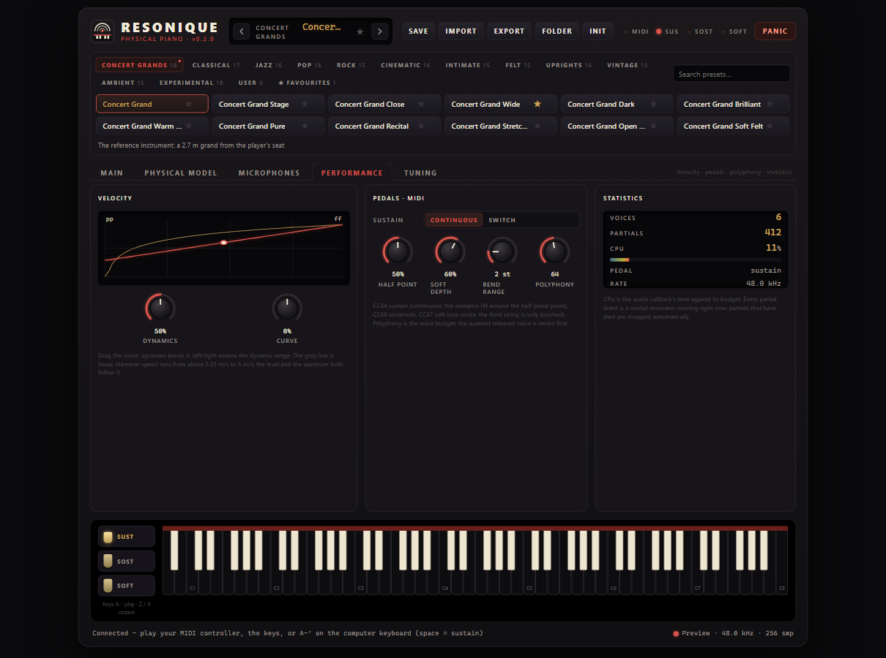
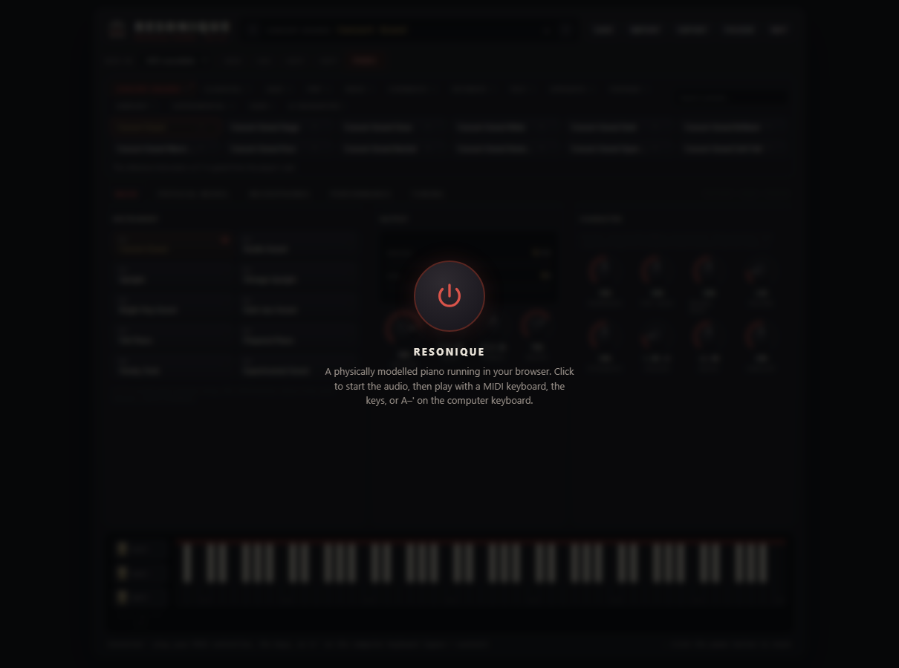
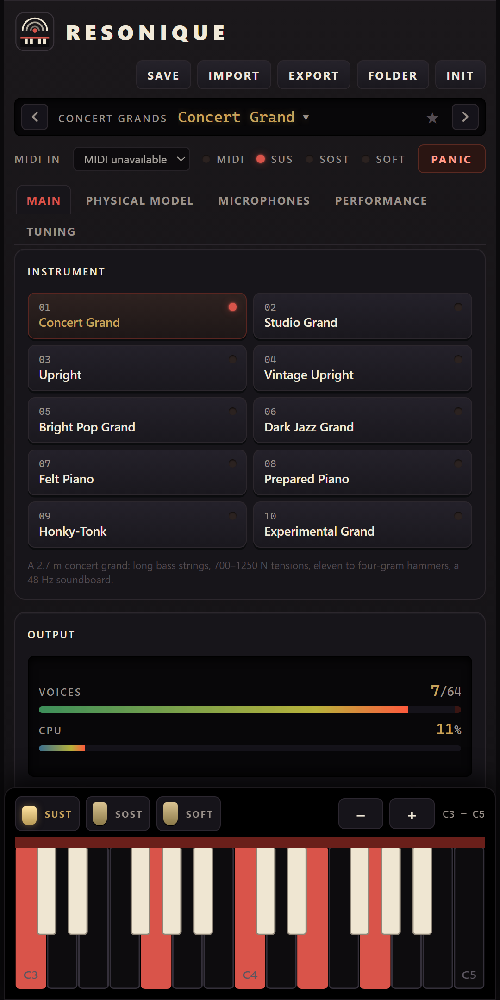
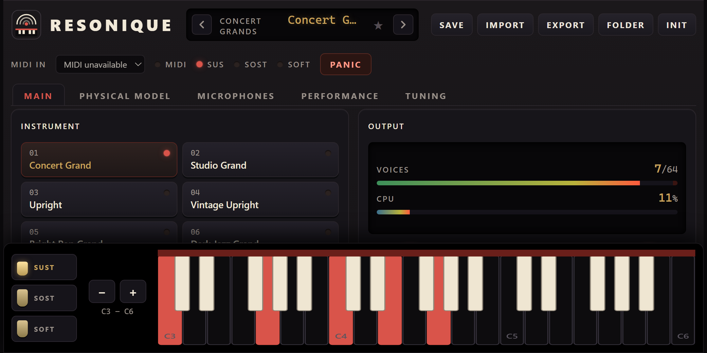

# Resonique — v0.2

Resonique is a physically modelled acoustic piano: no samples, every note is computed from a stiff-string modal
model struck by a nonlinear felt hammer, coupled through a modal soundboard that carries sympathetic resonance back
into every undamped string. It is a Windows x64 **VST3 plugin** and a **Standalone app**, and the sixth instrument
in the family after [E-Piano](https://github.com/BlinkZer0/E-PianoVST), Brass Knuckles, No Strings, The Ham and
Eight Ball: same console, same preset system, same build.

| Build | Where | Status |
|---|---|---|
| **VST3 plugin** + Standalone | [`vst/`](vst/README.md) | phases 1–12 of the plan built and tested: the engine, ten instruments, 190 presets, the five-page console, automated DSP / acoustic / preset / instrument / robustness / host tests, benchmark, release packaging |
| **Web** (browser) | [`web/index.html`](web/index.html), [`docs/index.html`](docs/index.html) for GitHub Pages | the same engine compiled to WebAssembly (phase 13): one self-contained page, the same UI and factory presets, Web MIDI, presets in the browser plus `.rqpreset` import / export; `start.bat` serves it locally |
| **Android** (Google Play) | [`android/`](android/README.md) | the web build in a native app (phase 14): signed `.aab` + `.apk`, native MIDI (USB / Bluetooth), portrait and landscape phone layouts, adaptive grand-piano icon, and the whole Play Console kit in [`android/store/`](android/store/listing.md) (listing, screenshots, privacy policy, terms, data safety) |


| PHYSICAL MODEL | MICROPHONES |
|---|---|
|  |  |

| PERFORMANCE | TUNING |
|---|---|
|  |  |

(made by `vst\tests\run-ui-tests.ps1` from the real UI with a stand-in bridge; `run-standalone-check.ps1`
screenshots the real Standalone window.)

## What it does

**The model** (details in [docs/ACOUSTICS.md](docs/ACOUSTICS.md))
- **Strings:** up to 128 modes per string, stiff-string partial series `f_n = n·f₀·√((1+Bn²)/(1+B))` with *B* from
  each key's length, tension and core diameter; losses from air, viscoelasticity and the soundboard's admittance;
  rotation resonators in float with no trigonometry in the audio loop. Partials that have died are dropped.
- **Hammer:** a mass with a Hunt–Crossley felt law `F = K·ξ^p·(1+λξ̇)`; harder blows shorten the contact and
  brighten the tone. Integrated at 192 kHz sub-steps so the result is the same at every sample rate.
- **Unisons:** one, two or three strings per key with per-string detune and a local bridge (mass + resistance) that
  couples them: beating and two-stage decay fall out of the physics.
- **Soundboard:** 96 shared modes over eight bridge zones, radiating to left and right with their own weights;
  the zone accelerations feed back into every undamped string.
- **Sympathetic resonance:** a light modal copy of every key rings when its damper is off, driven by the board,
  so harmonically related keys respond and others do not.
- **Pedals:** continuous sustain (half-pedal, re-pedalling), sostenuto, soft (una corda), with the dampers acting on
  the actual string losses; the top twenty keys have no dampers.
- **Mechanical noises:** synthesised hammer / key / damper / pedal sounds, mostly through the soundboard.
- **Microphones and room:** player / close / audience / wide / mono / custom perspectives, early reflections, an
  8-line FDN reverb (Room, Chamber, Hall, Stage) or your own impulse response.
- **Tuning:** equal plus seven historical temperaments, Scala `.scl` import, concert pitch, Railsback stretch, a
  per-note detune editor.

**Ten instruments:** Concert Grand, Studio Grand, Upright, Vintage Upright, Bright Pop Grand, Dark Jazz Grand, Felt
Piano, Prepared Piano, Honky-Tonk, Experimental Grand: different string scalings, hammers, dampers and boards, not
EQ presets.

**190 factory presets** in 12 categories (Concert Grands, Classical, Jazz, Pop, Rock, Cinematic, Intimate, Felt,
Uprights, Vintage, Ambient, Experimental), generated from physical recipes, level-matched, each one a distinct set
of synthesis parameters (the build refuses near-duplicates). Search, categories, favourites, user presets with
categories, import / export, init, previous / next, DAW session recall.

**Playing:** MIDI notes with velocity, CC64 / 66 / 67, pitch bend, all-notes-off / all-sound-off; an 88-key
on-screen keyboard with pedal buttons; the computer keyboard (A–', Z / X, Space for the pedal); 128 voices with
quiet-first stealing; right-click on any control for the DAW's automation menu.

## Measured (v0.2, `ResoniqueTests`)

| What | Result |
|---|---|
| Fundamental tuning, A0..A7 | within 1.2 cents of the target on every tested key |
| First eight partials of C4 | within 0.4 % of the stiff-string formula |
| Decay (T60 of the fundamental) | C2 15 s · C4 10 s · C6 5.7 s · E7 1.7 s (reference recordings: 21 / 15–23 / 7 / 2.7 s) |
| Hammer contact | 5.2 ms at C1, 2.1 ms at C4, 1.3 ms at C6, 0.9 ms at G#7 at velocity 64; shorter at 120 |
| Velocity 20 → 127 at C4 | level −43 → −19 dBFS (24 dB), spectral centroid 485 → 1050 Hz, both monotonic (reference ff ≈ 1030 Hz) |
| Against 16 reference notes (University of Iowa piano, mf and ff, C1–C7) | mean differences: spectral centroid 2.5 dB · inharmonicity 5.6 dB · partials 2 / 3 7.1 / 8.1 dB · broadband decay at 1 / 2 s 3.9 / 6.2 dB |
| Compass balance at velocity 90 | peaks within 3 dB from C1 to C8 |
| Sympathetic resonance | C4 with the pedal down makes the C3 copy ring 40× more than C#3 |
| Pedal, 1.1 s after release | up −138 dB · half −74 dB · down −46 dB |
| Coupled-network stability | 88 keys at ff with every coupling, resonance and decay at maximum settles in every combination (`--probe-stability`) |
| Sample rates 44.1 / 48 / 88.2 / 96 / 192 kHz | same pitch within 0.01 %, same level within 0.2 dB, same spectral centroid within 3 % |
| CPU (48 kHz, Release, AVX2 kernels selected at run time) | 16 voices 7 % · 32 voices + pedal 11 % · 64 + pedal 19 % · 88 + pedal 24 % of one core; idle 1.5 %; tables rebuild in 2.6 ms |
| Host check | loads like a DAW, 48 + MIDI parameters, programs, state round trip |
| Real-time safety | zero heap allocations while rendering (counted); output bit-identical for block sizes 1 to 2048; table swaps and every live parameter swept while playing stay click-free; 5000-note MIDI flood bounded; idle cost after the notes die 2.4 % of a core |

The comparison (`ResoniqueTests --compare`, [docs/ACOUSTICS.md §10](docs/ACOUSTICS.md)) is against one piano in
one room through one microphone; the references are not bundled. What is **not** claimed: the instrument has not
been voiced by ear against an acoustic instrument or Pianoteq; `ResoniqueTests --render` writes the WAVs and
spectra to listen to and compare.

## VST3 plugin (`vst/`)

```
vst\build.bat      build VST3 + Standalone + tests (Release)
vst\install.bat    copy Resonique.vst3 to C:\Program Files\Common Files\VST3
vst\package.ps1    dist\Resonique-<version>-Windows-x64.zip (Standalone + VST3 + install notes)
```

Requirements: Windows, Visual Studio 2022 or 2026 (C++ workload), Git. JUCE 8.0.17 downloads automatically on the
first build (or a sibling project's copy is reused). Release builds link the MSVC runtime statically, so users need
only the WebView2 runtime (built into Windows 11 and current Windows 10). User presets live in
`Documents\Resonique\Presets`. Build details, the UI bridge, the tests and troubleshooting are in
[vst/README.md](vst/README.md); the house rules in [docs/CONVENTIONS.md](docs/CONVENTIONS.md); the plan and the
measurements per phase in [docs/PLAN.md](docs/PLAN.md).

## Web build (`web/`, `vst/webhost/`)

The same C++ engine (`vst/Source/PianoEngine.h` and `dsp/`) compiled to WebAssembly with Emscripten and driven
by `vst/webhost/web-host.js`, which stands in for the plugin's C++ side behind the same bridge the WebView2 UI
uses, so `vst/ui` runs unchanged. The result is **one file**, `web/index.html` (about 550 KB: UI, engine, factory
presets), copied to `docs/index.html` for GitHub Pages.

```
vst\webhost\build-web.ps1   em++ -> resonique.wasm, then assembles web\index.html and docs\index.html
start.bat                   serves web\ at http://localhost:8080 (the AudioWorklet path; file:// falls back to the main thread)
vst\tests\run-web-check.ps1 runs the wasm engine in Node, screenshots the page, plays a note through the AudioWorklet in headless Edge
```

In the browser: click the power button (browsers need a gesture to start audio), then play from a MIDI keyboard
(Web MIDI, all inputs or one), the on-screen keys or the computer keyboard. The note tables are built by a second
engine instance on the main thread and copied into the audio worklet, so changing a physical parameter never
stalls the sound. Presets save in the browser (localStorage) and import / export the same `.rqpreset` files as the
plugin; per-note detune and Scala files work; the impulse-response reverb is not available (the algorithmic rooms
are). Emscripten is found through `EMSDK`, `%LOCALAPPDATA%\ResoniqueVST\emsdk` or a sibling project's SDK.



## Android app (`android/`)

The web build packaged as a Play-Store-ready app the Brass Knuckles way: a full-screen WebView serving the bundled
page from a secure origin (so the engine runs in an AudioWorklet), a native MIDI bridge standing in for Web MIDI
(USB and Bluetooth MIDI), the system file dialogs for import and export, and no permissions at all. The shared UI
gained a phone layout: portrait stacks the panels in one column over a 25-key keyboard, landscape puts them two
across over 37 keys; the keyboard is pinned to the bottom with the pedals and octave buttons, and the preset browser
folds away behind the preset name.

```
android\build.bat           signed app-release.aab (Play upload) + app-release.apk (sideload); "build.bat debug" for a debug apk
android\store\make-graphics.ps1   icon-512, feature graphic and the four phone screenshots from the real page
node android\tests\check-device.js   installs the debug apk on a connected device and reads the page's state over DevTools
```

Store kit in [`android/store/`](android/store/listing.md): listing texts, app-content answers (content rating,
data safety, ads, target audience), release notes, the four screenshots, icon and feature graphic; the policy pages
Play links to are [`docs/privacy.html`](docs/privacy.html) and [`docs/terms.html`](docs/terms.html).

| Portrait | Landscape |
|---|---|
|  |  |

## Release history

**v0.2: the complete instrument (first release)**
- Phases 1–7: the JUCE/CMake project, the modal string engine with inharmonicity and losses, the nonlinear hammer,
  unisons with bridge coupling, the modal soundboard with sympathetic resonance and pedals, ten instruments, tuning,
  the five-page family console, 190 presets, the tests and the packaging.
- Phase 8: the modal loops vectorise (about 40 % less CPU per partial), decay recalibrated against the live
  coupling, sample-rate-independent measurements.
- Phase 9: calibrated against openly licensed reference recordings (decay, brightness, inharmonicity, partial
  balance); a renderer defect that brightened every note by 10 dB fixed; the soundboard exchange runs every
  sample so the coupled network settles at every setting.
- Phase 10: the nine derived instruments re-expressed relative to the calibrated grand (felt as force at a
  reference compression, losses and bridge loss as factors), a per-instrument metrics table and test
  (contact, inharmonicity, decay, brightness, level at C2 / C4 / C6), level trims per instrument.
- Phase 11: robustness suite (allocation counting, block-size invariance, sample-rate change, table swaps,
  parameter sweeps, MIDI floods, idle cost); the engine's control chunks keep a fixed phase across host
  blocks, the soundboard and the reverb sleep when rung down.
- Phase 12: the per-sample loops compiled for SSE2 and AVX2 with run-time selection.
- Phase 13: the web build (the engine as WebAssembly in an AudioWorklet, one self-contained page, Web MIDI,
  browser presets); two engine defects found on the way and fixed in the plugin too: the temperament, root,
  concert pitch and stretch parameters never reached the table builder (only the Scala / detune state did), and
  a panic left the output filters ringing into the freshly cleared reverb (a faint tail at −63 dB).
- Phase 14: the Android app (WebView + native MIDI bridge, signed App Bundle and APK, the phone layouts in the
  shared UI, the grand-piano icon, the Play Console kit: listing, screenshots, privacy policy, terms, data safety).
- Known limitations: the plugin is Windows only; the voicing is calibrated against measurements of one piano, not
  yet by ear; the 88-voice worst case costs about a quarter of a core; the Android app has been checked on a
  Samsung phone and a Quest 3 over DevTools (layout, AudioWorklet audio, a sounding note, MIDI ports), not yet
  played by hand.

## Repository layout

```
vst/                 VST3 plugin (JUCE 8): Source/, ui/, presets/, tests/, resources/, webhost/ (the web build's host + wasm API)
web/                 index.html: the web build (generated by vst/webhost/build-web.ps1); start.bat / serve.ps1 serve it
android/             the Android app (Gradle): app/, store/ (Play Console kit), tests/check-device.js, build.bat
docs/                ACOUSTICS.md (the model), CONVENTIONS.md (house rules), PLAN.md (phases + measurements), index.html (GitHub Pages copy of the web build), privacy.html, terms.html
renders/             ResoniqueTests --render output: spectrum CSVs are kept, WAVs are ignored by git
LICENSES.md          what the binaries contain
```
